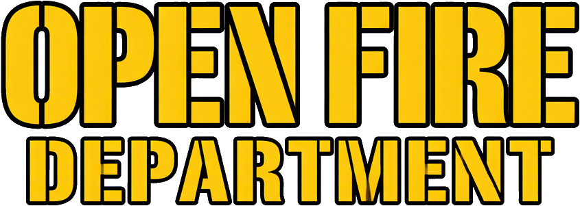
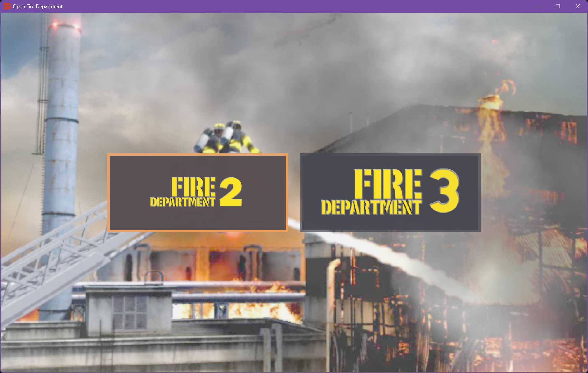
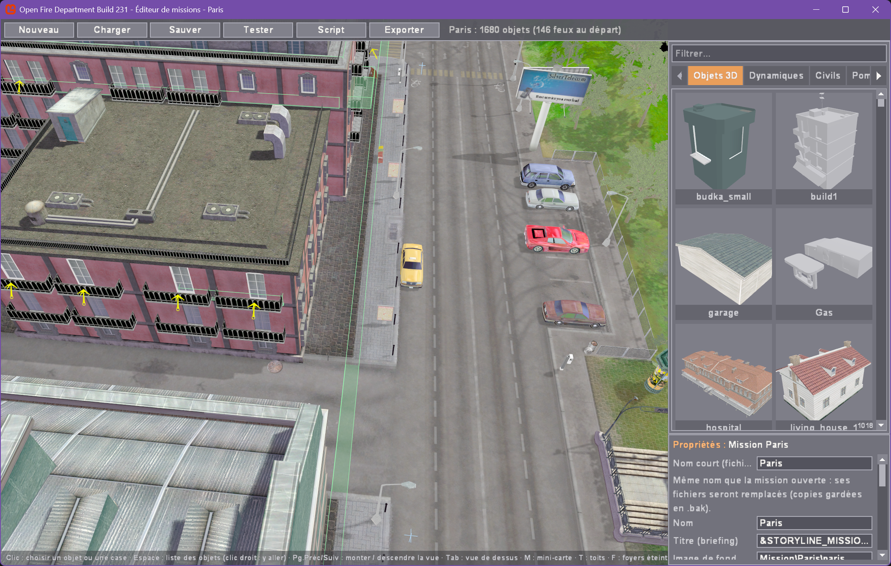
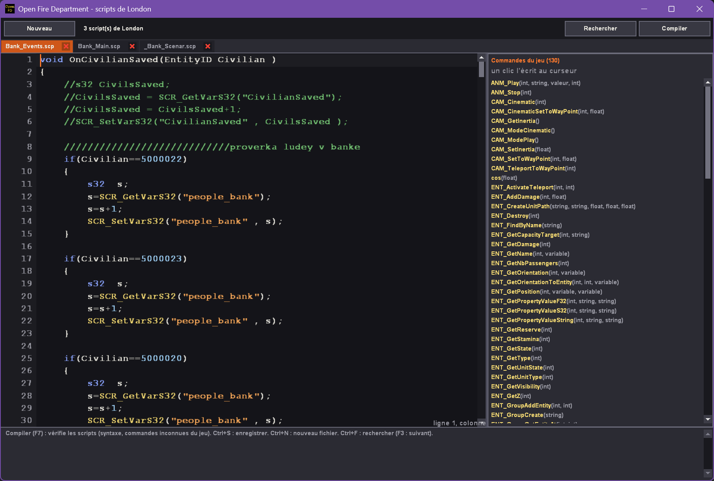
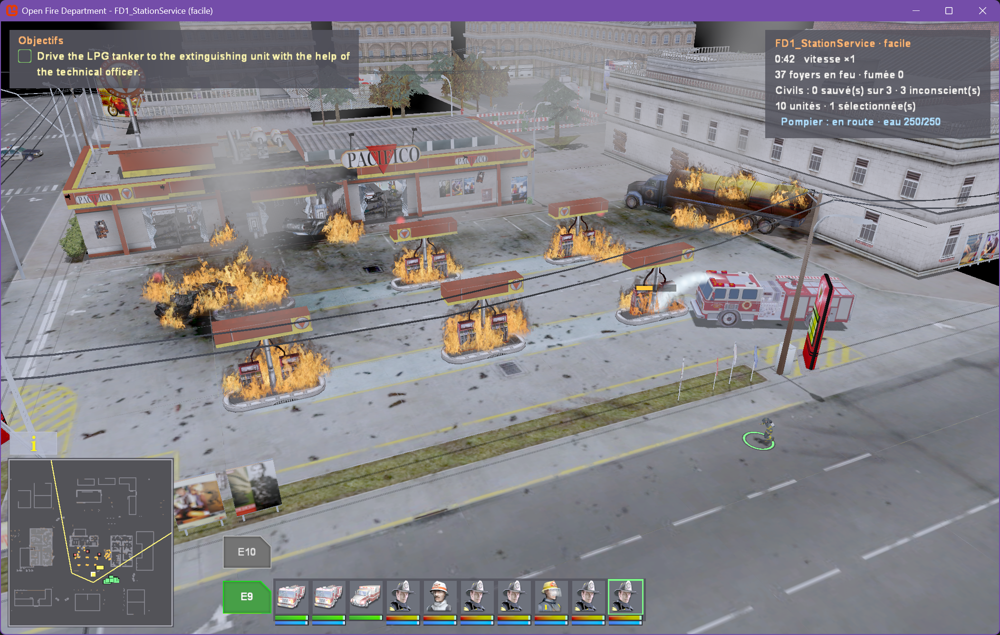
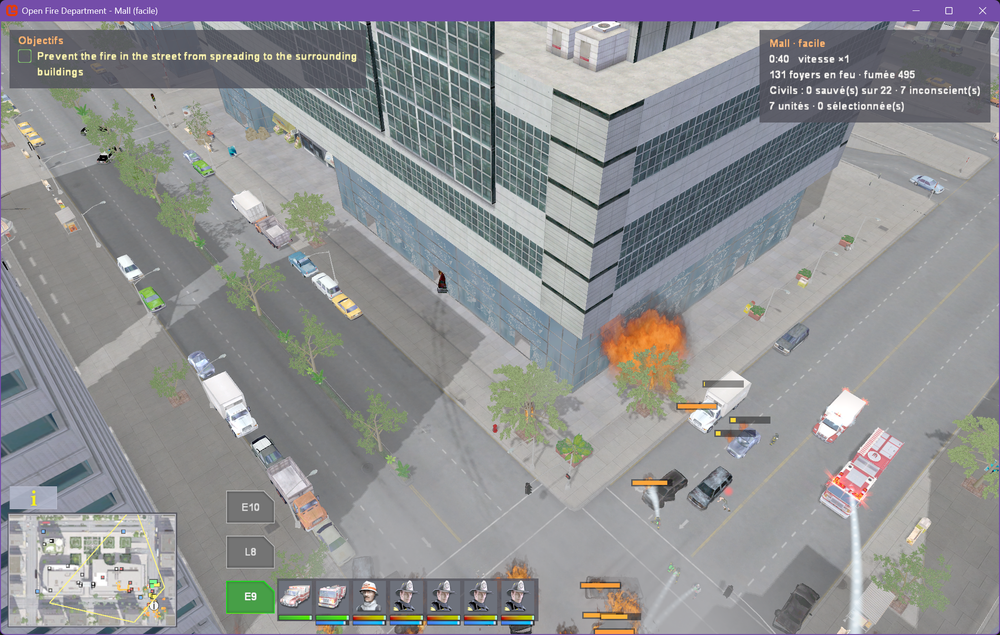
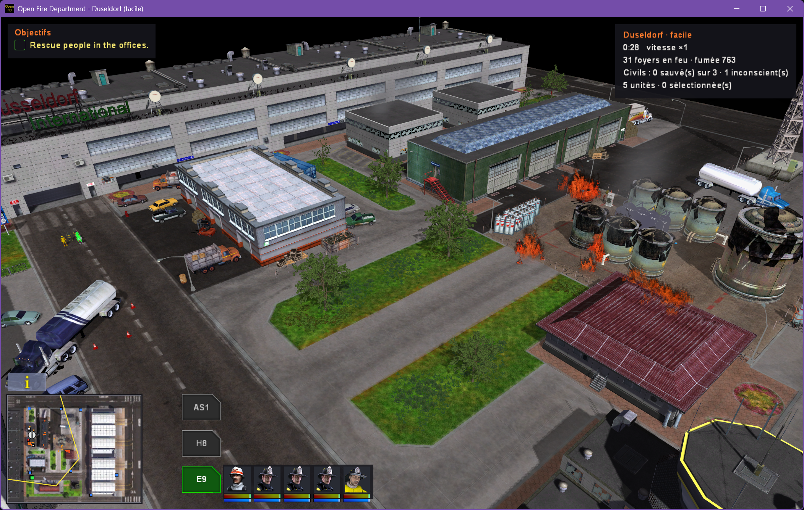

For who don't know the games : you control some firefighters and a large variety of vehicles of them (including canadair) to reach the mission
  
Extinguish fire, save all civilians, and much more...

-----------
## OpenFD

OpenFD — C# re-implementation of Fire Department 2 and 3 and a mission editor (and missions of Fire Department 1 with a converter included) (Original game from MonteCristo game studio)

A new engine that reads files from an original installation of Fire Department 2 and 3. For Windows and Linux (x64)

A converter is now included to convert missions/files of Fire Department 1, to be played in Fire Department 3 and OpenFD.

This engine support multiplayers

Support save/load game

Support multi-languages (French, English, German, Italian, Spanish)

No game data is included in this repository but demo version is included (3 missions, 1 for each game)

-----------
## The game

Simply launch exe, without command lines, will launch the game with demo version of games

Launch exe with in argument the path where Fire Department 2 or 3 is installed, like that :

OpenFD.exe "C:\Games\Fire Department 3"

You can specify two path, to set the two games, like that :

OpenFD.exe "C:\Games\Fire Department 3" "C:\Games\Fire Department 2"

---------------------
## The mission editor

You can make your own missions and share it

----------------
## The converter

The converter is a tool that convert mission of Fire Department 1 to a format of Fire Department 3 and so, for OpenFD.

Command line :

OpenFD.ConvFD1 <Path root of Fire Department 1> <Path of "Data" of Fire Department 3/OpenFD> NameOfMissionToConvert

----------------
Go to wiki https://github.com/FilRip/FireDepartment/wiki
To know more

-------------------------
Thank you to support me please :

Missions Editor :

Scripts Editor :

Fire Department 1 included mission : Fuel station

Fire Department 2 included mission : The mall

Fire Department 3 included mission : Dusseldorf Airport

